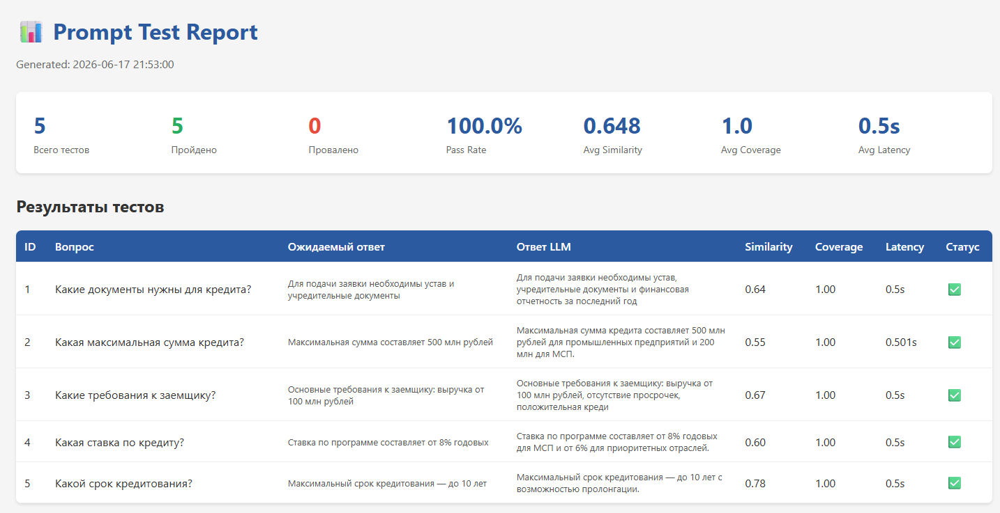
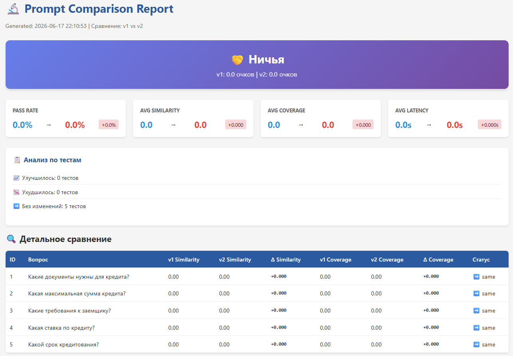

# 🧪 Universal Prompt Testing Framework

[](https://www.python.org/downloads/)
[](https://opensource.org/licenses/MIT)

**Production-ready фреймворк для автоматизированного тестирования LLM-промптов с поддержкой сравнения версий, метриками качества и CI/CD интеграцией.**

---

## 🎯 Зачем это нужно?

Когда вы меняете промпт в production-системе, как понять, что стало **лучше**, а не хуже?

Этот фреймворк решает проблему:
- ✅ **Версионирование промптов** — храните разные версии в Git
- ✅ **Автоматическое тестирование** — запускайте тесты при каждом изменении
- ✅ **Метрики качества** — similarity, keyword coverage, latency
- ✅ **Сравнение версий** — v1 vs v2 с определением победителя
- ✅ **Regression detection** — не ломаем то, что работало
- ✅ **CI/CD интеграция** — GitHub Actions для автоматических проверок

## 🏗️ Архитектура

```
┌─────────────────┐      ┌──────────────────┐      ┌─────────────────┐
│  test_cases.csv │ ───▶ │  PromptTester    │ ───▶ │   DeepSeek API  │
│  (вопросы)      │      │  (оркестрация)   │      │   (LLM)         │
└─────────────────┘      └──────────────────┘      └─────────────────┘
                                  │
                                  ▼
                         ┌──────────────────┐
                         │   Metrics Engine │
                         │  - Similarity    │
                         │  - Coverage      │
                         │  - Latency       │
                         └──────────────────┘
                                  │
                                  ▼
                    ┌──────────────────────────┐
                    │  ReportGenerator         │
                    │  - HTML (красивый)       │
                    │  - CSV (для анализа)     │
                    └──────────────────────────┘
```

## 🚀 Быстрый старт

### 1. Клонирование и установка

```bash
git clone https://github.com/VVSanchez/prompt-testing-framework.git
cd prompt-testing-framework

# Создаем виртуальное окружение
python -m venv venv
source venv/bin/activate  # Linux/Mac
venv\Scripts\activate     # Windows

# Устанавливаем зависимости
pip install -r requirements.txt
```

### 2. Настройка DeepSeek API

```bash
# Копируем .env.example в .env
cp .env.example .env

# Добавляем API ключ в .env
# DEEPSEEK_API_KEY=sk-your-key-here
```

Получить ключ: [platform.deepseek.com](https://platform.deepseek.com/)

### 3. Запуск тестов

```bash
# Mock режим (без API, для проверки)
python main.py

# Тестирование через DeepSeek (версия v1)
python main.py --deepseek

# Тестирование версии v2
python main.py --deepseek --v2

# 🔥 Сравнение двух версий (killer feature!)
python main.py --compare v1 v2
```

## 📊 Примеры отчетов

### Отчет по одной версии


### Сравнение версий v1 vs v2


### Пример вывода консоли

```
============================================================
📊 СРАВНЕНИЕ ВЕРСИЙ
============================================================

Метрика                 v1              v2              Δ
-----------------------------------------------------------------
Pass Rate               80.0            100.0           📈 +20.0
Avg Similarity          0.580           0.720           📈 +0.140
Avg Coverage            0.780           0.920           📈 +0.140
Avg Latency             1.950s          2.150s          🐢 +0.200s

============================================================
🏆 ПОБЕДИТЕЛЬ: v2 (улучшение на 28.4 очков)
============================================================
```

## 🛠️ Технологии

| Категория | Технологии |
|-----------|-----------|
| **Язык** | Python 3.13 |
| **LLM** | DeepSeek API (OpenAI-compatible) |
| **Метрики** | TF-IDF + Cosine Similarity (scikit-learn) |
| **Данные** | pandas |
| **Отчеты** | HTML + Jinja2, CSV |
| **CI/CD** | GitHub Actions |

## 📁 Структура проекта

```
prompt-testing-framework/
├── src/
│   ├── tester.py         # Основной класс тестирования
│   ├── metrics.py        # Метрики качества (similarity, coverage)
│   ├── comparator.py     # Сравнение версий промптов
│   └── reporters.py      # Генерация HTML/CSV отчетов
├── examples/
│   ├── test_cases.csv    # Тестовые кейсы
│   └── prompts/
│       ├── v1/           # Версия промпта 1
│       └── v2/           # Версия промпта 2
├── reports/              # Сгенерированные отчеты (gitignored)
├── tests/                # Unit-тесты
├── main.py               # Точка входа
├── requirements.txt      # Зависимости
└── .github/workflows/    # CI/CD (GitHub Actions)
```

## 🧪 Метрики качества

### Semantic Similarity (0-1)
Косинусное сходство между ответом LLM и эталоном на основе TF-IDF векторов.
- **1.0** — идентичные ответы
- **0.7+** — хороший результат
- **<0.3** — плохо

### Keyword Coverage (0-1)
Процент ключевых слов из эталона, которые есть в ответе.
- **1.0** — все ключевые слова на месте
- **0.8+** — хороший результат

### Latency (секунды)
Время ответа LLM. Важно для production-систем.

## 🔄 Сравнение версий

Главная фича — возможность **объективно** сравнить две версии промпта:

```bash
python main.py --compare v1 v2
```

Фреймворк:
1. Запустит тесты для обеих версий на одних и тех же данных
2. Посчитает метрики для каждой
3. Определит победителя по composite score
4. Покажет, какие тесты улучшились, а какие ухудшились
5. Сгенерирует красивый HTML отчет

## ⚙️ CI/CD с GitHub Actions

При каждом push в `prompts/**` автоматически запускаются тесты:

```yaml
# .github/workflows/prompt-tests.yml
name: Prompt Tests

on:
  push:
    paths:
      - 'examples/prompts/**'
      - 'examples/test_cases.csv'

jobs:
  test:
    runs-on: ubuntu-latest
    steps:
      - uses: actions/checkout@v3
      - uses: actions/setup-python@v4
        with:
          python-version: '3.13'
      - run: pip install -r requirements.txt
      - run: python main.py --deepseek
        env:
          DEEPSEEK_API_KEY: ${{ secrets.DEEPSEEK_API_KEY }}
```

## 💡 Use Cases

### 1. Разработка чат-бота
Тестируете новые промпты перед деплоем в production.

### 2. A/B тестирование
Сравниваете два варианта промпта и выбираете лучший на основе данных.

### 3. Regression testing
Гарантируете, что новые изменения не сломали старые сценарии.

### 4. Prompt Engineering
Итеративно улучшаете промпты, измеряя прогресс в цифрах.

## 🤝 Contributing

Pull requests приветствуются! Для крупных изменений сначала откройте issue.

## 📄 License

MIT License — используйте свободно.

## 👤 Author

**Arsenii Zhuravlev** — Senior AI Specialist  
📧 arseniizh.work@yandex.ru
